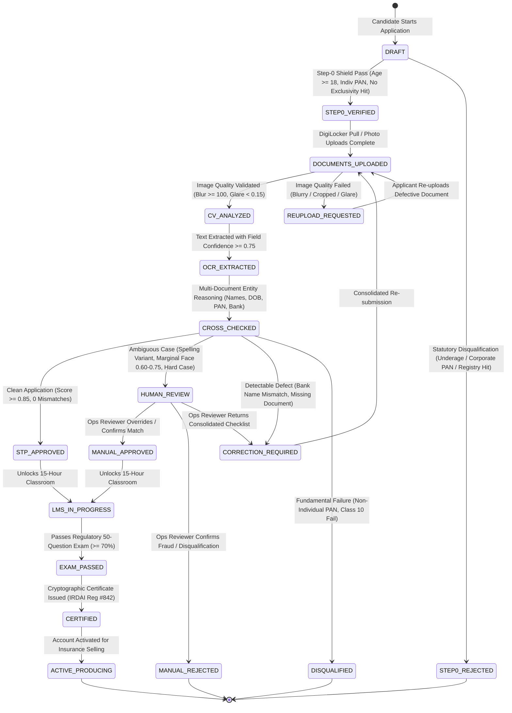
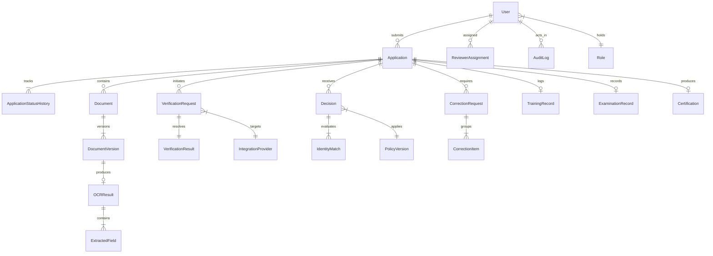
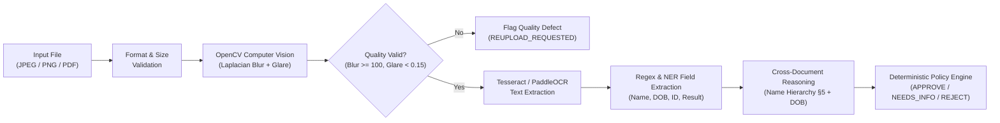

# PolicyNest AI-First POSP Onboarding Suite — System Architecture
**Document ID:** PN-ARCH-2026-V1  
**Author:** Principal Software Architect  
**Effective Date:** 8 November 2026  
**Status:** ARCHITECTURAL SPECIFICATION BASELINE

---

## 1. High-Level Architecture Diagram

```mermaid
flowchart TD
    subgraph ClientLayer["Presentation Layer (Client Browsers & Mobile Viewports)"]
        UI_App["Applicant Portal (join.policynest.com)"]
        UI_Ops["Ops Reviewer Cockpit (ops.policynest.com)"]
        UI_Admin["Executive Analytics & ABAC (admin.policynest.com)"]
        UI_LMS["15-Hour LMS Classroom (learn.policynest.com)"]
        UI_WA["Two-Way WhatsApp Copilot HUD"]
    end

    subgraph SecurityGateway["Security & Access Enforcement (PEP)"]
        AUTH["Bearer Token & Session Authenticator"]
        RBAC_Gate["RBAC Role Filter (Applicant vs Ops vs SuperAdmin)"]
        ABAC_PEP["NIST SP 800-162 Policy Enforcement Point"]
        RATE["Token Bucket Rate Limiter"]
    end

    subgraph BackendCore["FastAPI Asynchronous Application Services"]
        API_App["Application Lifecycle & State Machine"]
        API_Doc["Document Ingestion & Private Vault"]
        API_CV["Computer Vision Image Quality Engine (OpenCV)"]
        API_OCR["Document Intelligence & Field Parser"]
        API_Match["Cross-Document Identity Reasoning Engine"]
        API_Rule["Deterministic Policy Decision Engine (v3.2)"]
        API_ML["Random Forest Classifier (100 Trees, scikit-learn)"]
        API_ABAC_PDP["NIST ABAC Policy Decision Point"]
        API_Analytics["GA4 / PostHog Telemetry Collector"]
    end

    subgraph IntegrationLayer["Provider-Independent Integration Gateway"]
        INT_DL["DigiLocker Partner Requester Adapter (Sandbox)"]
        INT_PAN["NSDL / Income Tax PAN Validation Adapter"]
        INT_Aadhaar["UIDAI Masked Offline XML Adapter"]
        INT_Bank["NPCI IMPS Penny Drop & Escrow Switch"]
        INT_DLT["Telecom DLT SMS Notification Gateway"]
        INT_LMS["Internal Regulatory LMS Course Engine"]
    end

    subgraph Persistence["Enterprise Persistence Layer (SQLite WAL / PostgreSQL)"]
        DB_Apps[("applications & status_history")]
        DB_Docs[("documents & document_versions")]
        DB_Users[("users & role_permissions")]
        DB_Audit[("audit_trail & abac_access_logs")]
        DB_Analytics[("analytics_sessions & analytics_events")]
        Vault[("Encrypted Private Document Storage (AES-256)")]
    end

    ClientLayer --> SecurityGateway
    SecurityGateway --> BackendCore
    BackendCore --> IntegrationLayer
    BackendCore --> Persistence
    IntegrationLayer -.-> Persistence
```



---

## 2. POSP Lifecycle State Machine



---

## 3. Normalized Database Entity Model (23 Core Entities)



### Entity Schema Definitions

1. **`users`**:
   - `id` (INTEGER, PK), `uuid` (TEXT, UNIQUE), `mobile` (TEXT, UNIQUE), `email` (TEXT), `full_name` (TEXT), `role` (TEXT), `clearance_level` (INTEGER, 1-3), `assigned_region` (TEXT), `password_hash` (TEXT), `token` (TEXT), `created_at` (TIMESTAMP), `last_login_at` (TIMESTAMP).
2. **`roles`**:
   - `id` (INTEGER, PK), `role_name` (TEXT, UNIQUE), `permissions_json` (TEXT), `description` (TEXT).
3. **`applications`**:
   - `application_id` (TEXT, PK), `user_id` (INTEGER, FK), `declared_name` (TEXT), `declared_dob` (DATE), `declared_pan` (TEXT), `declared_education` (TEXT), `declared_state` (TEXT), `penny_drop_name` (TEXT), `stage` (TEXT), `final_decision` (TEXT), `ai_confidence` (REAL), `is_stp` (BOOLEAN), `is_hard_case` (BOOLEAN), `risk_score` (REAL), `assigned_reviewer_id` (TEXT), `created_at` (TIMESTAMP), `updated_at` (TIMESTAMP).
4. **`application_status_history`**:
   - `id` (INTEGER, PK), `application_id` (TEXT, FK), `from_stage` (TEXT), `to_stage` (TEXT), `actor_id` (TEXT), `reason` (TEXT), `timestamp` (TIMESTAMP).
5. **`documents`**:
   - `id` (INTEGER, PK), `application_id` (TEXT, FK), `doc_type` (TEXT), `status` (TEXT), `current_version_id` (INTEGER), `created_at` (TIMESTAMP).
6. **`document_versions`**:
   - `id` (INTEGER, PK), `document_id` (INTEGER, FK), `version_number` (INTEGER), `file_path` (TEXT), `file_hash_sha256` (TEXT), `mime_type` (TEXT), `file_size_bytes` (INTEGER), `image_quality_status` (TEXT), `blur_variance` (REAL), `glare_ratio` (REAL), `is_active` (BOOLEAN), `created_at` (TIMESTAMP).
7. **`ocr_results`**:
   - `id` (INTEGER, PK), `version_id` (INTEGER, FK), `provider` (TEXT), `raw_text` (TEXT), `overall_confidence` (REAL), `processing_latency_ms` (INTEGER), `created_at` (TIMESTAMP).
8. **`extracted_fields`**:
   - `id` (INTEGER, PK), `ocr_result_id` (INTEGER, FK), `field_name` (TEXT), `field_value` (TEXT), `confidence` (REAL), `bounding_box_json` (TEXT).
9. **`verification_requests`**:
   - `id` (INTEGER, PK), `application_id` (TEXT, FK), `provider_id` (TEXT), `verification_type` (TEXT), `idempotency_key` (TEXT), `status` (TEXT), `request_payload_masked` (TEXT), `created_at` (TIMESTAMP).
10. **`verification_results`**:
    - `id` (INTEGER, PK), `request_id` (INTEGER, FK), `external_txn_id` (TEXT), `response_status` (TEXT), `response_payload_masked` (TEXT), `assurance_level` (TEXT), `created_at` (TIMESTAMP).
11. **`identity_matches`**:
    - `id` (INTEGER, PK), `application_id` (TEXT, FK), `source_doc_a` (TEXT), `source_doc_b` (TEXT), `field_name` (TEXT), `value_a` (TEXT), `value_b` (TEXT), `match_category` (TEXT), `similarity_score` (REAL), `rulebook_code` (TEXT), `status` (TEXT).
12. **`decisions`**:
    - `id` (INTEGER, PK), `application_id` (TEXT, FK), `policy_version` (TEXT), `decision` (TEXT), `reasons_json` (TEXT), `ai_recommendation` (TEXT), `human_override` (BOOLEAN), `author_id` (TEXT), `timestamp` (TIMESTAMP).
13. **`correction_requests`**:
    - `id` (INTEGER, PK), `application_id` (TEXT, FK), `round_number` (INTEGER), `status` (TEXT), `dispatch_channel` (TEXT), `message_en` (TEXT), `message_hi` (TEXT), `created_at` (TIMESTAMP), `resolved_at` (TIMESTAMP).
14. **`correction_items`**:
    - `id` (INTEGER, PK), `correction_request_id` (INTEGER, FK), `document_type` (TEXT), `issue_code` (TEXT), `issue_description` (TEXT), `remediation_instruction` (TEXT), `status` (TEXT).
15. **`training_records`**:
    - `id` (INTEGER, PK), `application_id` (TEXT, FK), `modules_completed` (INTEGER), `total_modules` (INTEGER), `time_spent_seconds` (INTEGER), `is_eligible_for_exam` (BOOLEAN), `completed_at` (TIMESTAMP).
16. **`examination_records`**:
    - `id` (INTEGER, PK), `application_id` (TEXT, FK), `attempt_number` (INTEGER), `score_pct` (INTEGER), `passed` (BOOLEAN), `answers_json` (TEXT), `timestamp` (TIMESTAMP).
17. **`certifications`**:
    - `id` (INTEGER, PK), `application_id` (TEXT, FK), `certificate_id` (TEXT, UNIQUE), `irdai_registration_no` (TEXT), `valid_from` (DATE), `valid_thru` (DATE), `cert_pdf_path` (TEXT), `sha256_hash` (TEXT), `issued_at` (TIMESTAMP).
18. **`abac_access_logs`**:
    - `id` (INTEGER, PK), `subject_id` (TEXT), `subject_role` (TEXT), `subject_region` (TEXT), `resource_id` (TEXT), `resource_state` (TEXT), `action` (TEXT), `decision` (TEXT), `policy_matched` (TEXT), `reason` (TEXT), `timestamp` (TIMESTAMP).
19. **`analytics_sessions`**:
    - `session_id` (TEXT, PK), `visitor_id` (TEXT), `ip_address` (TEXT), `device_type` (TEXT), `browser` (TEXT), `state` (TEXT), `created_at` (TIMESTAMP), `last_active_at` (TIMESTAMP).
20. **`analytics_events`**:
    - `id` (INTEGER, PK), `session_id` (TEXT, FK), `event_name` (TEXT), `event_category` (TEXT), `stage_index` (INTEGER), `metadata_json` (TEXT), `timestamp` (TIMESTAMP).

---

## 4. NIST SP 800-162 ABAC Decision Flow

The platform implements Attribute-Based Access Control following NIST Special Publication 800-162:

```
        [Client Request]
               │
               ▼
   [Policy Enforcement Point (PEP)]
               │ (Captures Subject, Resource, Action, Environment)
               ▼
   [Policy Decision Point (PDP)] <──> [Policy Information Point (PIP)]
               │                                (Fetches DB Attributes)
               ▼
    [Evaluates Rules 0 - 4]
               │
       ┌───────┴───────┐
       ▼               ▼
   [PERMIT]         [DENY]
       │               │
       │ (Logs Audit)  │ (Logs Audit + Throws HTTP 403)
       ▼               ▼
[Execute Action]  [Blocked Response]
```

---

## 5. Document Quality & Entity Reasoning Engine


