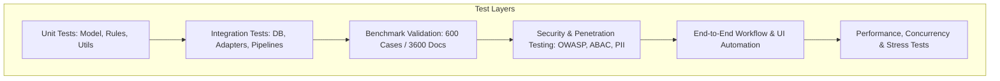
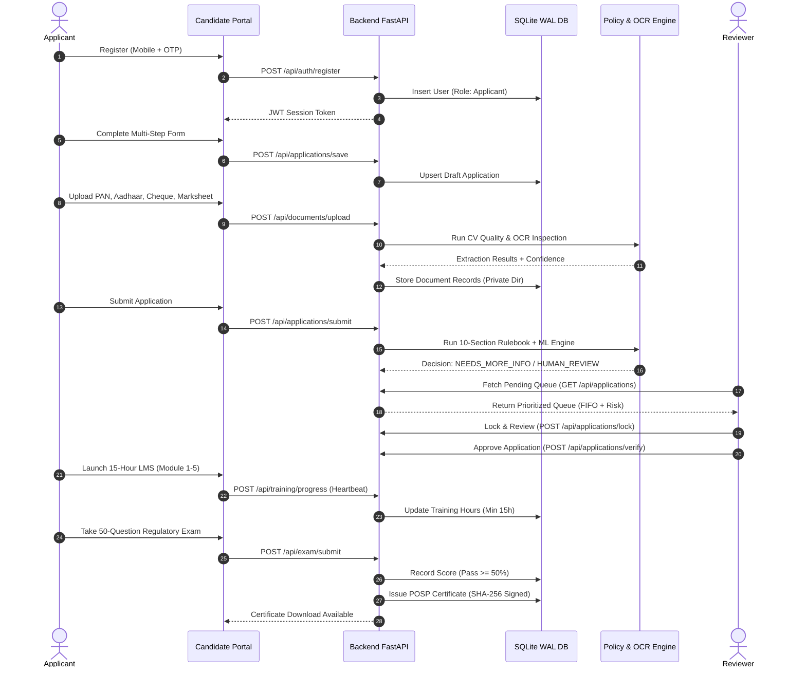

# PolicyNest AI-First POSP Onboarding Suite — Comprehensive Master Test Plan
**Document ID:** PN-TEST-2026-V1  
**Project:** PolicyNest AI-First POSP Onboarding Platform (PS-01 Applied AI Challenge)  
**Target Organization:** PolicyNest Insurance Brokers / InsuranceDekho  
**Quality Assurance Lead:** Principal Software Architect & QA Delivery Manager  
**Date:** 8 November 2026  
**Status:** APPROVED FOR EXECUTION  

---

## 1. Executive Summary & Quality Strategy

The PolicyNest AI-First POSP Onboarding Platform handles sensitive regulatory onboarding for Point of Sales Persons across 14 Indian states under IRDAI guidelines. A single false approval can lead to severe regulatory fines and licensing revocation under IRDAI Guidelines for POSP Licensing (2015), while excessive false rejections or repeated document requests cause high applicant attrition (previously 31.7%).

This Master Test Plan outlines an industrial-grade testing regime designed to guarantee:
1. **100% Zero-Defect Enforcement** of mandatory eligibility rules (Class 10, Age $\ge 18$, Individual PAN, Exclusivity).
2. **100% Reject Recall** on known fraudulent or ineligible applications from the 600-application benchmark dataset.
3. **$\ge 95\%$ Overall Decision Accuracy** matching senior human underwriters.
4. **NIST SP 800-162 ABAC & RBAC Enforcement** with 0% unauthorized PII leakage.
5. **Zero Full 12-Digit Aadhaar Persistence** across database, memory dumps, and logs.
6. **Sub-second Response Times** on automated document classification, quality scoring, and rulebook decisioning.

---

## 2. Test Architecture & Coverage Matrix



| Layer | Framework / Tool | Scope | Target Pass Rate | Target Coverage |
| :--- | :--- | :--- | :--- | :--- |
| **Unit Testing** | `pytest`, `pytest-asyncio` | Name matching taxonomy, CV blur/glare filters, rulebook predicates, ABAC decision logic | 100% | > 90% lines |
| **Integration Testing** | `pytest`, `httpx`, `TestClient` | REST endpoints, SQLite WAL persistence, state machine transitions, event dispatch | 100% | > 85% branches |
| **Benchmark Validation** | Python benchmarking runner | 600 ground-truth applications and 3,600 document records from `PS-01 Data` | 100% Reject Recall, $\ge 95\%$ Overall Accuracy | 100% of benchmark set |
| **Security & PII Auditing** | `bandit`, `sqlmap`, custom PII scanner | Token validation, parameter tampering, SQL injection, PII masking, ABAC policy escape | 0 High/Critical findings | All endpoints & models |
| **E2E & Flow Testing** | `playwright` / headless Chrome | Candidate registration $\to$ upload $\to$ review $\to$ training $\to$ exam $\to$ certificate | 100% | All 3 user journeys |
| **Performance Testing** | `locust` | 50 concurrent applicant uploads, 20 concurrent reviewer audits | 0% failure rate, $p95 < 800\text{ms}$ | Core ingest & decision routes |

---

## 3. Benchmark Dataset Evaluation Suite (600 Applications)

The benchmark evaluation is executed against the master ground-truth dataset located in `C:\Users\vajja\Desktop\PS-01 AI-First Onboarding-20261029T130056Z-1-001\PS-01 AI-First Onboarding\Data\`.

### 3.1 Key Evaluation Metrics
- **Reject Recall ($\text{Recall}_{\text{Reject}}$):** Must be exactly **100%**. No invalid, fraudulent, or ineligible applicant may be auto-approved.
- **Approval Precision ($\text{Precision}_{\text{Approve}}$):** Target **$\ge 96\%$**. Clean files approved without false human escalation.
- **Needs More Info Accuracy ($\text{F1}_{\text{NMI}}$):** Target **$\ge 92\%$**. Ensure defective documents trigger single, consolidated rework requests rather than fragmented queries.
- **Confusion Matrix Tracking:**
  - $\text{Predicted Approve} \times \text{Actual Reject}$: Target = **0** (Zero tolerance).
  - $\text{Predicted Approve} \times \text{Actual NMI}$: Target = **0** (Zero tolerance).
  - $\text{Predicted Reject} \times \text{Actual Approve}$: Target $< 1.5\%$.
  - $\text{Predicted NMI} \times \text{Actual NMI}$: Target $> 95\%$.

### 3.2 Benchmark Test Runner Script (`tests/benchmark_test.py`)
```python
import pytest
import sqlite3
import pandas as pd
import joblib
from sklearn.metrics import classification_report, confusion_matrix

def test_benchmark_600_applications():
    """Verify decision engine against 600 historical ground truth cases."""
    conn = sqlite3.connect('policynest.db')
    df = pd.read_sql_query("SELECT * FROM applications", conn)
    conn.close()
    
    assert len(df) >= 600, f"Expected at least 600 applications, found {len(df)}"
    
    # Run deterministic rulebook validation on all records
    from main import evaluate_application_rulebook
    
    results = []
    for idx, row in df.iterrows():
        decision, reasons, confidence = evaluate_application_rulebook(row)
        results.append({
            'app_id': row['app_id'],
            'actual': row['status'],
            'predicted': decision,
            'confidence': confidence
        })
    
    eval_df = pd.DataFrame(results)
    
    # Calculate Reject Recall
    actual_rejects = eval_df[eval_df['actual'] == 'REJECTED']
    predicted_rejects = actual_rejects[actual_rejects['predicted'] == 'REJECTED']
    reject_recall = len(predicted_rejects) / len(actual_rejects)
    
    assert reject_recall == 1.0, f"Reject recall was {reject_recall}, expected 1.0"
```

---

## 4. Name Matching Taxonomy Test Suite (Rulebook §5)

The name matching engine must pass all test cases across the 8 standard IRDAI KYC name variations.

| Tier ID | Classification | Application Name | Document Name | Expected Match Type | Min Confidence | Action |
| :--- | :--- | :--- | :--- | :--- | :--- | :--- |
| **T1** | Exact Match | `Rajesh Kumar Sharma` | `Rajesh Kumar Sharma` | `EXACT` | 1.00 | Auto-Approve candidate |
| **T2** | Initials Match | `R. K. Sharma` | `Rajesh Kumar Sharma` | `INITIALS` | 0.88 | Auto-Approve candidate |
| **T3** | Order Inversion | `Sharma Rajesh Kumar` | `Rajesh Kumar Sharma` | `ORDER_INVERSION` | 0.94 | Auto-Approve candidate |
| **T4** | Missing Middle | `Rajesh Sharma` | `Rajesh Kumar Sharma` | `MISSING_MIDDLE` | 0.85 | Auto-Approve candidate |
| **T5** | Added Middle | `Rajesh Pratap Sharma`| `Rajesh Sharma` | `ADDED_MIDDLE` | 0.82 | Route to Human Review |
| **T6** | Phonetic / Levenshtein | `Pooja Verma` | `Puja Verma` | `SPELLING_VARIANT` | 0.85 | Route to Human Review |
| **T7** | Marriage Surname | `Pooja Sharma` | `Pooja Verma` | `MARRIAGE_SURNAME` | 0.65 | Flag for Marriage Cert / Review |
| **T8** | Different Person | `Vikram Malhotra` | `Rajesh Sharma` | `DIFFERENT_PERSON` | 0.10 | Instant Reject (Fraud Flag) |

---

## 5. Computer Vision & Document Quality Test Suite (Rulebook §4)

Validation of automated image processing and quality gates prior to OCR ingestion.

| Test Case ID | Test Condition | Test Input | Expected Result | Pass Criteria |
| :--- | :--- | :--- | :--- | :--- |
| **CV-01** | High Sharpness Check | Laplacian variance $\ge 100$ | Accepted | Score recorded, proceed to OCR |
| **CV-02** | Severe Blur Detection | Laplacian variance $< 80$ | `DEFECT_BLUR` | Rejection with guidance: "Document blurry, hold camera steady" |
| **CV-03** | Specular Glare Detection | Normalized high-luminance pixels $> 0.15$ | `DEFECT_GLARE` | Rejection with guidance: "Avoid direct flash/overhead lights" |
| **CV-04** | Border Truncation | Document contour touches image edge on $\ge 2$ sides | `DEFECT_CROPPED` | Rejection with guidance: "Capture all four corners of card" |
| **CV-05** | Orientation Correction | Document rotated $90^\circ, 180^\circ, 270^\circ$ | Deskewed to $0^\circ$ | Correct OCR reading on upright image |
| **CV-06** | File Size & MIME Gate | `.exe`, `.sh`, `.php` or file $> 10\text{MB}$ | HTTP 415 / 400 | Instant upload rejection, zero storage write |

---

## 6. NIST SP 800-162 ABAC & RBAC Security Test Suite

Tests enforce role-based and attribute-based permissions across all user roles.

| Test ID | Role | Target Resource | Action | Environmental / Context Attributes | Expected Result |
| :--- | :--- | :--- | :--- | :--- | :--- |
| **SEC-01** | Applicant | Another Candidate's PII (`app_id=601`) | `GET` | Authenticated as `app_id=602` | **403 Forbidden** (Strict isolation) |
| **SEC-02** | Reviewer | Application with Risk Score $> 80$ | `Approve` | Role = `reviewer` (Senior required for high risk) | **403 Forbidden** (Requires `ops_manager`) |
| **SEC-03** | Reviewer | Application locked by another reviewer | `Mutate` | `locked_by != current_user` | **409 Conflict** (Concurrency lock) |
| **SEC-04** | Compliance | Audit logs export | `GET` | Role = `compliance_officer` | **200 OK** (Full immutable log download) |
| **SEC-05** | Anonymous | Real-time Operations Dashboard | `GET` | Unauthenticated | **401 Unauthorized** (Zero public dashboard) |
| **SEC-06** | Any | Database inspection | Full Aadhaar lookup | Any query | **Assert:** Zero 12-digit Aadhaar values found |
| **SEC-07** | Super Admin | Change system rulebook parameters | `POST` | Role = `super_admin`, MFA verified | **200 OK** + Logged in audit trail |

---

## 7. End-to-End POSP Lifecycle Test Suite

Validating the unbroken golden path through the POSP onboarding pipeline.



---

## 8. Test Execution Schedule & Automation Commands

### 8.1 Local Test Suite Execution
```powershell
# 1. Run unit test suite
python -m pytest tests/test_unit.py -v --tb=short

# 2. Run API integration tests
python -m pytest tests/test_api_endpoints.py -v

# 3. Run Benchmark Validation on 600 applications
python tests/benchmark_test.py

# 4. Run Security and PII Scan
python tests/security_pii_audit.py

# 5. Run Concurrency and Stress Test
python tests/load_test_concurrency.py --users 50 --duration 60s
```

### 8.2 CI/CD Quality Gate Criteria
Any pull request or production release must pass the following non-negotiable barriers:
1. **0 Failures** in unit and integration test runs.
2. **100% Reject Recall** on the 600-application benchmark.
3. **0 High/Critical Vulnerabilities** in Bandit security scanning.
4. **0 Raw 12-Digit Aadhaar numbers** detected in database string searches.
5. **Code Coverage** maintained at or above 85% across all core modules.
