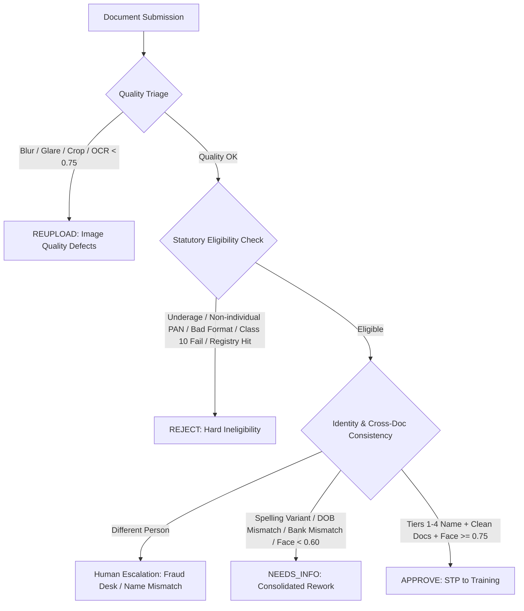

# Specimen Defect Taxonomy & Failure Modes Engineering Guide

This guide details the failure modes, OCR degradation scenarios, biometric anomalies, and identity defects encountered in POSP onboarding documents, referencing the official 14 reason codes and 12 specimen cases.

---

## 1. Defect Category Hierarchy

---

## 2. Comprehensive Defect Analysis by Category

### 2.1 Image Quality Defects (Verdict: `REUPLOAD`)

| Defect Code | Computer Vision Indicator | Root Cause | Rework Action | Automated Messaging Template |
| :--- | :--- | :--- | :--- | :--- |
| `IMAGE_BLURRY` | Laplacian variance < 100.0 or OCR word confidence < 0.75 | Camera shake, out-of-focus mobile capture, low lighting | Request new photograph in daylight | *"Your {doc_name} photo is blurry, and we could not clearly read required fields like {field_name}. Please retake in bright natural light with steady focus: {upload_link}"* |
| `IMAGE_CROPPED` | Edge detection fails to find 4 document corners; bounding box intersects canvas boundary | Applicant clipped card edge, cut off signature or DOB | Request full uncropped capture | *"A portion of your {doc_name} is cut off outside the camera frame. Please ensure all four corners and edges of the card are clearly visible: {upload_link}"* |
| `IMAGE_GLARE` | Specular reflection detected; local pixel luminance saturation (> 245) over text region | Direct flash or overhead bulb reflection washing out text | Request capture without flash | *"Direct light reflection or flash hides key information on your {doc_name}. Please retake without camera flash or angle the phone away from direct lights: {upload_link}"* |

### 2.2 Statutory Disqualifications (Verdict: `REJECT`)

| Defect Code | Detection Rule | Statutory Basis | System Action | Rework Permitted? |
| :--- | :--- | :--- | :--- | :--- |
| `UNDERAGE` | `application_date - DOB < 18.0 years` | IRDAI Guidelines §4(a) | Terminal rejection. Account locked. | No. May reapply upon reaching age 18. |
| `PAN_FORMAT_INVALID` | Regex `^[A-Z]{5}[0-9]{4}[A-Z]$` fails | Income Tax Act §139A | Terminal rejection. | No. Invalid statutory document. |
| `PAN_NOT_INDIVIDUAL` | PAN character 4 != `'P'` (e.g. `'C'`, `'F'`, `'T'`, `'H'`) | Only individuals may act as POSPs | Terminal rejection. | No. Entity cannot be onboarded as POSP. |
| `EDU_NOT_ELIGIBLE` | Class 10 result != `PASS` or unaccredited board | IRDAI Guidelines §4(b) | Terminal rejection. | No. Minimum educational threshold not satisfied. |
| `ALREADY_REGISTERED`| POSP Registry query returns active sponsorship hit | IRDAI Exclusivity Mandate | Terminal rejection until NOC uploaded. | Conditional: Allowed only upon formal de-registration. |

### 2.3 Consistency & Rework Defects (Verdict: `NEEDS_INFO`)

| Defect Code | Detection Rule | Resolution Path | Automation Rule |
| :--- | :--- | :--- | :--- |
| `NAME_SPELLING_VARIANT`| Jaro-Winkler >= 0.85 or Levenshtein <= 2 (e.g. `LAKSHMI` vs `LAXMI`) | Request supporting identity document or affidavit | Send consolidated WhatsApp/SMS notification; allow applicant to confirm canonical spelling |
| `DOB_MISMATCH` | PAN DOB != Aadhaar DOB or Marksheet DOB | Golden anchor is PAN DOB | If Aadhaar has year-only matching PAN year: AUTO-PASS. If full date conflict: Request clarification |
| `BANK_NAME_MISMATCH` | Penny-drop name similarity < Tier 4 | Account must be in applicant's own name | Request cancelled cheque or bank statement showing applicant as sole or primary holder |
| `FACE_MATCH_LOW` | Face embedding cosine similarity < 0.60 | Low lighting, heavy filter, or wrong person | Request real-time liveness selfie. If 2nd attempt fails: Route to Fraud Desk |

---

## 3. Ground Truth Calibration Rules

1. **Rule of Single-Pass Rework:** If an application has both `IMAGE_BLURRY` on Marksheet and `BANK_NAME_MISMATCH` on Cheque, the system MUST emit a single notification itemizing both defects. Never ask for one document at a time.
2. **Rule of Human Confirmation for Rejection on Identity:** When `NAME_MISMATCH` is flagged, the system MUST NOT auto-reject without human review, ensuring false positives from OCR failures do not penalize genuine applicants.
3. **Informational Mismatches:** Address state discrepancies (`ADDRESS_STATE_MISMATCH`) between Aadhaar and declared form must NEVER trigger rework or rejection; they are informational only.
