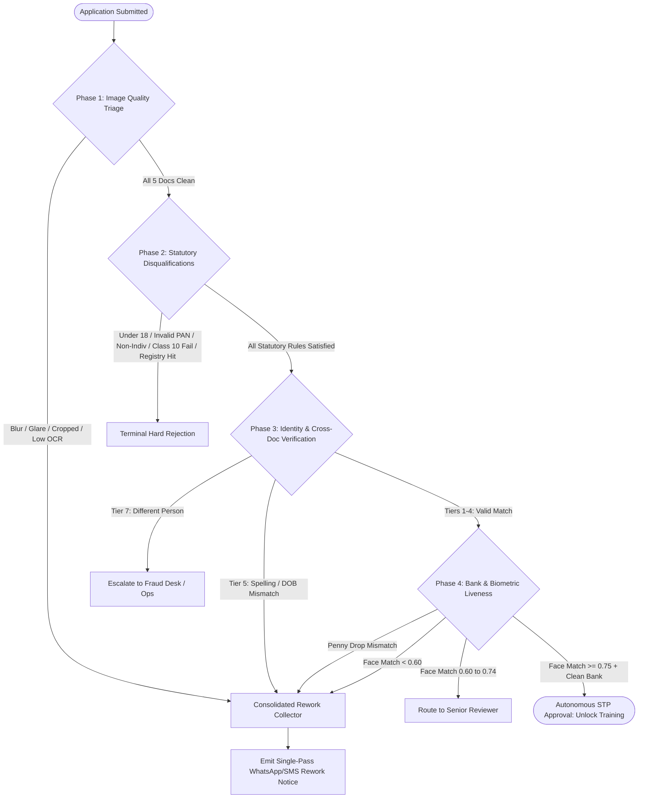

# Policy Engine Architecture & Deterministic Decision Hierarchy

> **Technical Specification for the Automated Decision Engine**  
> **Project:** PolicyNest AI-First POSP Onboarding Platform  
> **Source Base:** Masters' Union Applied AI Challenge (Rulebook v3.2 & Labelled Benchmark)

---

## 1. Engine Overview & Architecture

The PolicyNest Decision Engine operates as a hybrid deterministic and probabilistic policy evaluation system. It takes structured OCR extractions, image quality vectors, declared demographic inputs, and external API responses (Penny-Drop, IRDAI Central Registry) to produce a definitive, auditable verdict for every onboarding application.



---

## 2. Deterministic Decision Hierarchy

The evaluation follows a strict multi-tier hierarchy to prevent redundant processing and eliminate false-positive rejections:

### Phase 1: Input Quality & Legibility Gate
- **Condition:** Every uploaded document must have all 4 corners visible, no specular glare obscuring text, and OCR confidence $\ge 0.75$.
- **Defects:** `IMAGE_BLURRY`, `IMAGE_CROPPED`, `IMAGE_GLARE`.
- **Verdict:** If any document fails quality, it is queued for rework. Processing does not halt; remaining documents are inspected to bundle all rework items.

### Phase 2: Statutory Disqualification Gate (Hard Rejection)
- **Conditions:**
  1. Age on application date $\ge 18.00$ years.
  2. PAN matches regex `^[A-Z]{5}[0-9]{4}[A-Z]$` and character 4 is `'P'`.
  3. Class 10 marksheet result is `PASS` from a recognized board.
  4. IRDAI Central POSP Registry lookup returns zero active registrations (`registry_hit == False`).
- **Defects:** `UNDERAGE`, `PAN_FORMAT_INVALID`, `PAN_NOT_INDIVIDUAL`, `EDU_NOT_ELIGIBLE`, `ALREADY_REGISTERED`.
- **Verdict:** Immediate `REJECT`. All discovered statutory disqualifications are listed in the final decision report.

### Phase 3: Identity & Cross-Document Consistency Gate
- **Anchor:** The Name and DOB on the PAN card serve as the golden reference values.
- **Cross-Checks:**
  - PAN Name vs Aadhaar Name
  - PAN Name vs Class 10 Marksheet Name
  - PAN DOB vs Aadhaar DOB (year-only is accepted if year matches)
  - PAN DOB vs Class 10 Marksheet DOB
- **Defects:**
  - `NAME_MISMATCH` (Different Person): Routed to Human Reviewer; AI never auto-rejects identity without human confirmation.
  - `NAME_SPELLING_VARIANT` (Phonetic / Minor Spelling): Routed to `NEEDS_MORE_INFO`.
  - `DOB_MISMATCH`: Routed to `NEEDS_MORE_INFO`.

### Phase 4: Financial & Biometric Liveness Gate
- **Bank Penny-Drop Check:** Name returned from bank must match PAN name under Tiers 1–4. If not: `BANK_NAME_MISMATCH` (`NEEDS_MORE_INFO`).
- **Face Match Biometrics:**
  - Score $\ge 0.75$: **PASS**
  - Score $0.60 \le S < 0.75$: **HUMAN_REVIEW** (Reviewer evaluates lighting, age gap)
  - Score $< 0.60$: `FACE_MATCH_LOW` (`NEEDS_MORE_INFO`). Second failure escalates to Fraud Desk.

---

## 3. Decision Conflict Resolution & Multi-Issue Aggregation

When an application exhibits multiple issues across different documents:
1. **Rejection Trumps Rework:** If an applicant fails a hard statutory rule (e.g. `UNDERAGE` or `PAN_NOT_INDIVIDUAL`), the verdict is `REJECT`, but any image quality issues are suppressed to avoid asking an ineligible applicant for re-uploads.
2. **Single-Pass Aggregation:** If multiple rework conditions exist (e.g., blurry marksheet, spelling variant in Aadhaar, and penny-drop mismatch), the engine collects all defects into an array:
   ```json
   {
     "final_decision": "NEEDS_MORE_INFO",
     "decision_reasons": ["IMAGE_BLURRY", "NAME_SPELLING_VARIANT", "BANK_NAME_MISMATCH"],
     "items_to_rework": [
       {"doc_type": "CLASS10_MARKSHEET", "reason": "IMAGE_BLURRY", "guidance": "Please re-upload a clear daylight photograph showing all 4 corners."},
       {"doc_type": "AADHAAR_FRONT", "reason": "NAME_SPELLING_VARIANT", "guidance": "Name spelling differs from PAN. Please confirm spelling or provide affidavit."},
       {"doc_type": "BANK_DOCUMENT", "reason": "BANK_NAME_MISMATCH", "guidance": "Bank account is not in your own name. Upload a cheque for your personal account."}
     ]
   }
   ```
