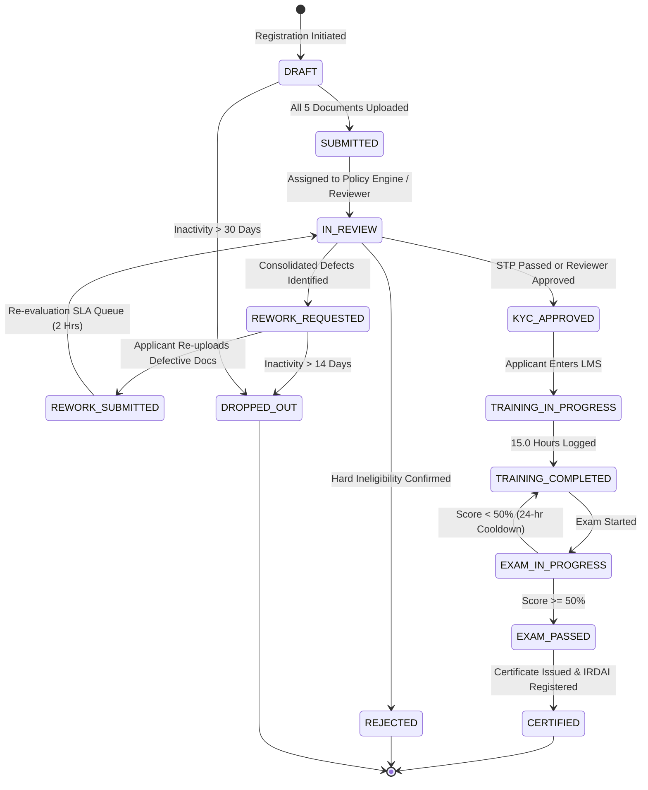

# POSP Application Lifecycle State Machine Specification

> **Finite State Machine (FSM) Specification & Event Sourcing Model**  
> **Source:** Rulebook v3.2 §6 & `stage_events.csv`

---

## 1. Application Lifecycle State Diagram

---

## 2. State Transition Table & Business Rules

| Current State | Triggering Event | Target State | Actor | Guard / Condition |
| :--- | :--- | :--- | :--- | :--- |
| `DRAFT` | `DOCS_UPLOADED` | `SUBMITTED` | `APPLICANT` | All 5 required documents present (`PAN`, `AADHAAR_FRONT`, `AADHAAR_BACK`, `CLASS10`, `BANK_CHEQUE`, `SELFIE`). |
| `SUBMITTED` | `TRIAGE_START` | `IN_REVIEW` | `SYSTEM` | Immediate asynchronous job dispatched to Policy Engine. |
| `IN_REVIEW` | `STP_PASS` | `KYC_APPROVED` | `SYSTEM` | All statutory rules met, Tiers 1-4 name match, face match $\ge 0.75$, clean bank penny-drop. |
| `IN_REVIEW` | `OPS_APPROVE` | `KYC_APPROVED` | `OPS_REVIEWER` | Human reviewer confirms identity/documents after manual inspection. |
| `IN_REVIEW` | `REWORK_TRIGGER`| `REWORK_REQUESTED`| `SYSTEM / REVIEWER`| Image quality defects, Tier 5 spelling, DOB mismatch, or bank name mismatch. Single-pass payload generated. |
| `IN_REVIEW` | `REJECT_CONFIRM`| `REJECTED` | `SYSTEM / REVIEWER`| Hard ineligibility (Age < 18, Invalid PAN, Registry Hit, Education Failed). Identity mismatch confirmed by human. |
| `REWORK_REQUESTED`| `REWORK_SUBMIT` | `REWORK_SUBMITTED` | `APPLICANT` | All requested documents re-uploaded by applicant. |
| `REWORK_SUBMITTED`| `PRIORITY_QUEUE`| `IN_REVIEW` | `SYSTEM` | Expedited review SLA (target: 2 working hours). |
| `KYC_APPROVED` | `LMS_LOGIN` | `TRAINING_IN_PROGRESS`| `APPLICANT` | Credentials provisioned; LMS modules unlocked. |
| `TRAINING_IN_PROGRESS`| `HOURS_LOGGED` | `TRAINING_COMPLETED`| `TRAINING_ENGINE`| Verified time logged $\ge 15.0	ext{ hours}$ across all required modules. |
| `TRAINING_COMPLETED`| `EXAM_START` | `EXAM_IN_PROGRESS` | `APPLICANT` | Online proctoring initialized. |
| `EXAM_IN_PROGRESS`| `EXAM_SUBMIT` | `EXAM_PASSED` | `SYSTEM` | Final exam score $\ge 50\%$. |
| `EXAM_IN_PROGRESS`| `EXAM_FAIL` | `TRAINING_COMPLETED`| `SYSTEM` | Score $< 50\%$. Cooldown timer of 24.0 hours enforced before next attempt. |
| `EXAM_PASSED` | `ISSUE_CREDENTIAL`| `CERTIFIED` | `SYSTEM` | IRDAI central registry notification generated; digital certificate signed. |
| Any Active | `INACTIVITY_TIMEOUT`| `DROPPED_OUT` | `SYSTEM` | 14 days without re-upload in `REWORK_REQUESTED` or 30 days inactivity in `DRAFT`. |
